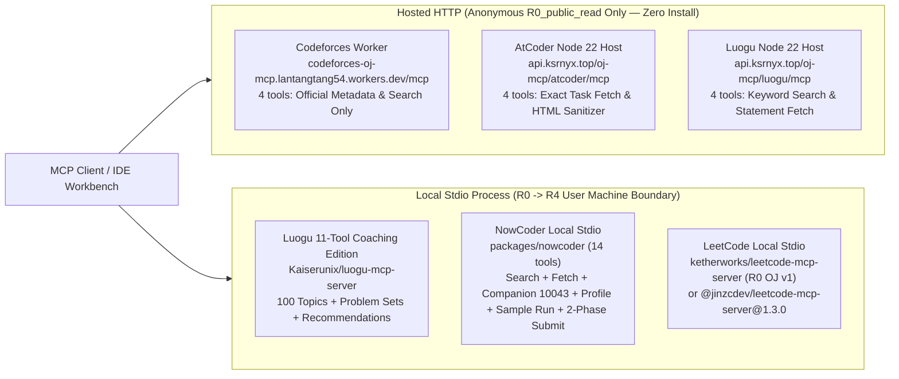
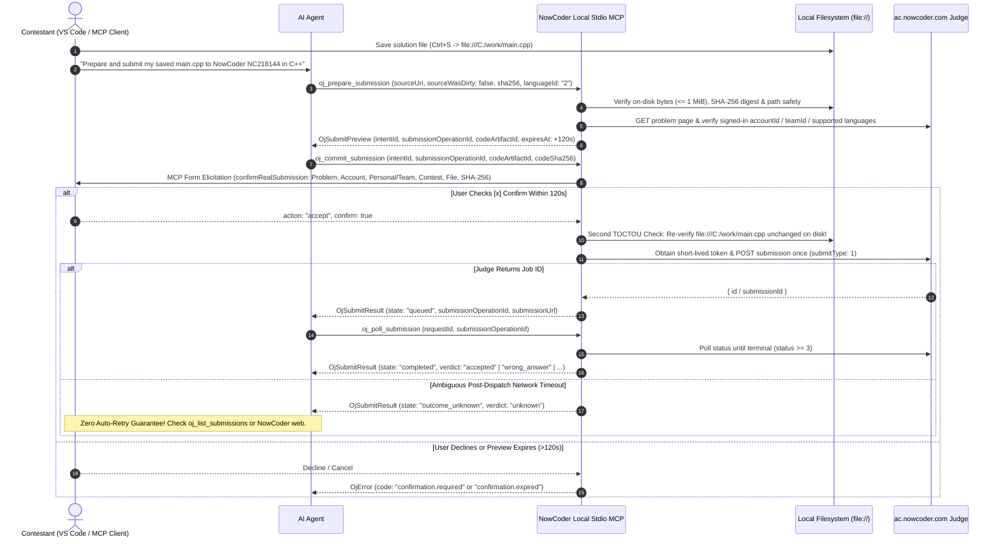

# UX Experience & Product Design Specification — `ketherworks/competitive-programming-mcp`

> [!IMPORTANT]
> **Code-Truthful Design Baseline**: Every critique, capability matrix, user journey, wireframe, and microcopy specification in this document is strictly verified against the live codebase (`packages/contracts`, `packages/server-common`, `packages/codeforces`, `packages/atcoder`, `packages/luogu`, `packages/nowcoder`, `packages/node-http-host`, `scripts/export-standalone.mjs`, `docs/*`, and the companion `ketherworks/leetcode-mcp-server` adapter). It synthesizes the joint Product Design audit (`@design-copy-5`) and end-to-end User Simulation walkthrough (`@ux-sim-5`). No unimplemented features are presented as shipped.

---

## 1. Executive Product & UX Critique

`ketherworks/competitive-programming-mcp` is a rigorously engineered **multi-platform Online Judge (OJ) Model Context Protocol (MCP) monorepo** built around a shared, security-bounded contract (`@kaiserunix/oj-mcp-contracts`, `oj.*/v1`). Its architectural strengths—which deserve headline placement—include:
1. **Zero-Key, Zero-Install Hosted HTTP Endpoints for 3 Major OJs (`Codeforces`, `AtCoder`, `Luogu`)**: Users can paste three HTTPS URLs and start querying problems in 15 seconds without API keys, browser cookies, or local builds.
2. **Explicit Risk Tiering (`R0_public_read` through `R4_real_submit`)** in [`packages/contracts/src/contracts.ts`](../packages/contracts/src/contracts.ts#L18): public HTTP servers strictly expose `R0_public_read` anonymous tools, keeping session cookies, source code, and real submissions isolated inside local `stdio` processes.
3. **NowCoder's Contest-Grade Safe Submission Architecture** in [`packages/nowcoder/src/judge.ts`](../packages/nowcoder/src/judge.ts#L159-L320), [`packages/nowcoder/src/artifact.ts`](../packages/nowcoder/src/artifact.ts), and [`packages/nowcoder/src/server.ts`](../packages/nowcoder/src/server.ts#L393-L463):
   - **Double TOCTOU Disk Verification**: Re-reads the physical `file:` URI from disk *before* confirmation and *again* before upload, verifying UTF-8 byte length (`<= 1 MiB`) and SHA-256 while rejecting dirty buffers (`sourceWasDirty: true`), UNC paths, and BiDi spoofing (`UNSAFE_DISPLAY_CHARACTER`).
   - **MCP-Native Form Elicitation (`server.elicitInput`)**: Displays an interactive confirmation form showing Problem ID, Personal vs. Team identity (`个人/团队`), Contest vs. Practice pool, Language ID, File Path, and SHA-256 within a 2-minute TTL (`INTENT_TTL_MS = 120_000`).
   - **Zero Auto-Retry on Ambiguous Timeout (`state: "outcome_unknown"`)**: Prevents duplicate-submission penalty minutes (+20 min in ACM/ICPC) by locking single-dispatch guarantees and switching strictly to read-only polling (`oj_poll_submission`).
   - **Least-Privilege Cookie Splitting & TLS Pinning** ([`packages/nowcoder/src/client.ts`](../packages/nowcoder/src/client.ts)): Full `NOWCODER_SESSION_COOKIE` goes only to `ac.nowcoder.com`; the access-token host receives only `csrf_token` and `NOWCODER*`; question metadata and judge hosts receive zero cookies.
4. **60-Second Ephemeral Loopback Competitive Companion Receiver** ([`packages/nowcoder/src/companion.ts`](../packages/nowcoder/src/companion.ts)): Opens `127.0.0.1:10043` on demand for at most 60 seconds, enforces `chrome-extension://` or `moz-extension://` CORS origin validation, accepts one problem payload, and immediately destroys all sockets.

However, **end-to-end user simulation across three realistic personas (`@ux-sim-5`) and code-level UX inspection (`@design-copy-5`) exposed nine high-friction UX and Developer Experience (DX) gaps during the first 60 seconds of onboarding**:

---

## 2. Simulated User Personas & End-to-End Walkthrough Audit (`@ux-sim-5` × `@design-copy-5`)

| Persona | Profile & Setup | Primary User Journey Tested | Exact Breakpoints Encountered (`file:line`) |
| --- | --- | --- | --- |
| **Persona 1: "Alex"**<br>*(International ICPC / Codeforces Div.2 Grinder)* | Cursor / VS Code on Windows; wants zero-install hosted HTTP MCPs for **Codeforces** and **AtCoder** to find `800–1400` rated `implementation`/`dp` problems and pull English statements + sample I/O. | 1. Paste root README hosted config.<br>2. Run root README prompt: `"Find five Codeforces implementation problems for beginners"` ([`README.md:53`](../README.md#L53)).<br>3. Ask for Codeforces `71/A` statement.<br>4. Run `"Fetch AtCoder problem abc086_a"` ([`README.md:54`](../README.md#L54)). | 1. **0 Results on README Prompt**: [`packages/codeforces/src/normalizers.ts:74-83`](../packages/codeforces/src/normalizers.ts#L74-L83) does literal whole-query substring matching against a single field and **completely ignores `difficulty.value` (rating)**. Multi-word queries like `"beginner implementation"` or `"implementation 800"` return `items: []`!<br>2. **No CF Statements**: Codeforces MCP exposes `codeforces_get_problem_metadata` (metadata only; no statement or samples).<br>3. **AtCoder Shorthand Rejection**: Passing `"abc086_a"` to `oj_search_problems` fails at [`packages/atcoder/src/provider.ts:284-286`](../packages/atcoder/src/provider.ts#L284-L286) because `exactSearchLocator` requires `"abc086/abc086_a"` or a full URL. |
| **Persona 2: "Lin"**<br>*(Chinese ACM / Autumn-Recruitment Student on Luogu & NowCoder)* | VS Code + Copilot Chat; wants hosted **Luogu** lookup and local **NowCoder** import, sample self-test (`oj_platform_run`), and confirmed submission (`oj_prepare_submission` -> `oj_commit_submission`) for `main.cpp`. | 1. Connect hosted Luogu URL from [`README.zh-CN.md:38`](../README.zh-CN.md#L38).<br>2. Choose between Luogu repos.<br>3. Clone `nowcoder-mcp-server` and configure stdio path.<br>4. Run `"为已保存的 main.cpp 生成提交预览"` ([`README.zh-CN.md:56`](../README.zh-CN.md#L56)). | 1. **Dead Luogu Worker URL**: Root README line 38 points to `https://luogu-mcp-server.lantangtang54.workers.dev/mcp`, which [`docs/deployment/production-endpoints.md:11,17-19`](deployment/production-endpoints.md#L11-L19) states was **removed due to upstream egress blocking** in favor of `https://api.ksrnyx.top/oj-mcp/luogu/mcp`.<br>2. **Luogu Split-Brain**: Root [`README.md:13`](../README.md#L13) links to `Kaiserunix/luogu-mcp-server` (11 `luogu_*` tools with training sets & 100 topics), while `packages/luogu` ships only 4 `oj_*` tools.<br>3. **LLM SHA-256 Ceremony Wall**: `oj_prepare_submission` ([`packages/nowcoder/src/judge.ts:159-181`](../packages/nowcoder/src/judge.ts#L159-L181)) forces the LLM to manually pass `providerId: "nowcoder-public-page"`, `accountId`, `platformLanguageId: "2"`, full `code.source`, exact UTF-8 `code.bytes`, precomputed 64-char hex `code.sha256`, `sourceUri: "file:///..."`, `sourceWasDirty: false`, and a complete `oj.problem-ref/v1`! |
| **Persona 3: "Sam"**<br>*(Bilingual Interview Prep Dev & Workbench Integrator — LeetCode Global/CN)* | Claude Code / VS Code user & downstream integrator connecting LeetCode (`leetcode.com` & `leetcode.cn`) and multi-OJ contracts. | 1. Follow [`docs/providers/leetcode.md`](providers/leetcode.md).<br>2. Launch `ketherworks/leetcode-mcp-server` (`@ketherworks/leetcode-mcp-private`).<br>3. Poll `oj_health` on startup.<br>4. Call `oj_fetch_problem` across all 5 platforms. | 1. **Unlinked Adapter**: `docs/providers/leetcode.md` tells users to run upstream `@jinzcdev/leetcode-mcp-server@1.3.0` and build their own `oj.*/v1` adapter, without linking `ketherworks/leetcode-mcp-server`!<br>2. **`LEETCODE_SESSION` Crash**: Having `LEETCODE_SESSION` in shell env aborts startup (`"LEETCODE_SESSION is forbidden for this anonymous adapter"`).<br>3. **Cold-Start False Alarm**: `oj_health` returns `overall: "degraded"` on cold start in Luogu ([`packages/luogu/src/provider.ts:223`](../packages/luogu/src/provider.ts#L223)) and LeetCode, unlike AtCoder/NowCoder (`"healthy"`).<br>4. **4 Incompatible `oj_fetch_problem` Input Shapes**: LeetCode rejects `{ nativeId: "two-sum" }` and requires a 13-field `oj.problem-ref/v1` + `oj.source-ref/v1` object. |

---

## 3. Nine Code-Verified UX & DX Friction Points (Detailed Root-Cause Analysis)

### 3.1 Friction #1 (P0): Broken Promise in Codeforces Search — Rating Ignored & Multi-Word Queries Return `[]`
- **Code Evidence**: [`README.md:11,53`](../README.md#L11), [`packages/codeforces/README.md:23,33`](../packages/codeforces/README.md#L23) vs. [`packages/codeforces/src/normalizers.ts:64-83`](../packages/codeforces/src/normalizers.ts#L64-L83).
- **Root Cause**:
  - Documentation advertises: *"Search official problem metadata by title, id, **rating**, and tag"* and prompts: `"Find five Codeforces implementation problems for beginners."`
  - However, `matchScore(summary, query)` only checks:
    ```ts
    if (id === query) return 100;
    if (id.includes(query)) return 80;
    const title = summary.title.toLocaleLowerCase();
    if (title === query) return 70;
    if (title.includes(query)) return 60;
    if (summary.tags.some((tag) => tag.name.toLocaleLowerCase().includes(query))) return 40;
    return 0;
    ```
  - `summary.difficulty?.value` (the Codeforces rating normalized at line 44) is **never inspected**. Searching `"800"` matches contest `800` (`800/A`) or `1800/A`, not rating `800`.
  - Furthermore, multi-word queries (`"beginner implementation"`, `"implementation 800"`, `"dp trees"`) are matched as one single literal substring against a single field, returning **0 results (`items: []`)**.

### 3.2 Friction #2 (P0): Stale Luogu Cloudflare Worker URL in Root Quick Start
- **Code Evidence**: [`README.md:38`](../README.md#L38) & [`README.zh-CN.md:38`](../README.zh-CN.md#L38) vs. [`docs/deployment/production-endpoints.md:11,17-19`](deployment/production-endpoints.md#L11-L19), [`packages/luogu/README.md:14`](../packages/luogu/README.md#L14), and [`scripts/export-standalone.mjs:90`](../scripts/export-standalone.mjs#L90).
- **Root Cause**: Root READMEs still list `https://luogu-mcp-server.lantangtang54.workers.dev/mcp`, even though `production-endpoints.md` explicitly records that the Luogu and AtCoder Cloudflare Workers were removed after real reads showed upstream egress blocking and replaced by the Node 22 HTTPS host (`https://api.ksrnyx.top/oj-mcp/luogu/mcp`).

### 3.3 Friction #3 (P0): Product Split-Brain — Two Luogu MCPs & Two LeetCode MCPs
- **Code Evidence**: [`README.md:13,15`](../README.md#L13-L15), [`packages/luogu/README.md:110-141`](../packages/luogu/README.md#L110-L141), [`docs/providers/leetcode.md:1-33`](providers/leetcode.md#L1-L33).
- **Root Cause**:
  - **Luogu Split**: Root `README.md:13` links to `Kaiserunix/luogu-mcp-server` (11 `luogu_*` tools: problem sets/training lists, 100 algorithm topics, pain-point recommendations, user profiles), while `packages/luogu` in this monorepo (exported to `ketherworks/luogu-mcp-server` as `@ketherworks/luogu-oj-mcp`) intentionally strips those down to 4 strict `oj_*` read-only tools.
  - **LeetCode Split**: `docs/providers/leetcode.md` instructs users to run `npx -y @jinzcdev/leetcode-mcp-server@1.3.0 --site global` and build their own `oj.*/v1` adapter, without linking `ketherworks/leetcode-mcp-server` (`@ketherworks/leetcode-mcp-private`), which implements that exact read-only `oj.*/v1` adapter.

### 3.4 Friction #4 (P1): Five Platforms, One Shared Contract Name, Four Incompatible `oj_fetch_problem` Input Schemas
- **Code Evidence**:
  - **Codeforces** ([`packages/codeforces/src/server.ts:21,25`](../packages/codeforces/src/server.ts#L21)): Does not expose `oj_fetch_problem`; exposes `codeforces_get_problem_metadata({ nativeId: "71/A" })` returning `OjProblemSummary` (no statement or samples).
  - **AtCoder** ([`packages/atcoder/src/provider.ts:33-47`](../packages/atcoder/src/provider.ts#L33-L47)): `oj_fetch_problem({ url, locale? } | { contestId, taskId, locale? })`. Does not accept `nativeId: "abc086/abc086_a"` or shorthand `"abc086_a"`.
  - **Luogu** ([`packages/luogu/src/provider.ts:43-49`](../packages/luogu/src/provider.ts#L43-L49)): `oj_fetch_problem({ nativeId: "P1001", locale?: "zh-CN", maxContentChars?: 200..50000 })`.
  - **NowCoder** ([`packages/nowcoder/src/server.ts:51-60`](../packages/nowcoder/src/server.ts#L51-L60)): `oj_fetch_problem({ url } XOR { nativeId: "NC218144" | "11244/A" })`.
  - **LeetCode** (`ketherworks/leetcode-mcp-server/src/oj/contracts.ts:166`): Rejects `{ nativeId: "two-sum" }` and requires a complete 7-field `oj.problem-ref/v1` + 6-field nested `oj.source-ref/v1` object.

### 3.5 Friction #5 (P1): Strict `oj.search-request/v1` Envelope Ceremony & Swallowed Zod Validation Paths
- **Code Evidence**: [`packages/atcoder/src/server.ts:118`](../packages/atcoder/src/server.ts#L118) vs. [`packages/codeforces/src/server.ts:157`](../packages/codeforces/src/server.ts#L157), [`packages/luogu/src/server.ts:183`](../packages/luogu/src/server.ts#L183), and [`packages/nowcoder/src/server.ts:304`](../packages/nowcoder/src/server.ts#L304).
- **Root Cause**: Calling `oj_search_problems` requires `{ "schemaVersion": "oj.search-request/v1", "requestId": "...", "platform": "...", "query": "...", "limit": 10 }`. When a caller omits a field or passes the wrong `platform` literal, AtCoder formats `issue.path.join("."): issue.message`, whereas Codeforces, Luogu, and NowCoder throw generic `"<toolName> input did not match its strict bounded schema."`, forcing developers to read TypeScript source to find which property failed.

### 3.6 Friction #6 (P1): Unworkable LLM Ceremony for NowCoder `oj_prepare_submission` & `oj_platform_run`
- **Code Evidence**: [`packages/nowcoder/src/server.ts:62-71`](../packages/nowcoder/src/server.ts#L62-L71), [`packages/nowcoder/src/judge.ts:159-181,361-388`](../packages/nowcoder/src/judge.ts#L159-L181).
- **Root Cause**: To satisfy the prompt `"Prepare my saved main.cpp for submission"`, the LLM must construct a deeply nested `oj.prepare-submission/v1` payload containing `providerId: "nowcoder-public-page"`, the user's numeric `accountId`, `platformLanguageId: "2"`, the full file text in `code.source`, exact UTF-8 byte count in `code.bytes`, exact 64-char lowercase SHA-256 hex in `code.sha256`, `code.sourceUri: "file:///..."`, `code.sourceWasDirty: false`, and a complete `oj.problem-ref/v1` object (including `source`). Chat LLMs cannot reliably compute SHA-256 digests or UTF-8 byte lengths of local files without external shell execution, causing `assertCodeHash` (`judge.ts:589-594`) to reject the request.

### 3.7 Friction #7 (P1): Cold-Start `oj_health` Reports `"degraded"` on Luogu (and LeetCode) vs. `"healthy"` on AtCoder & NowCoder
- **Code Evidence**: [`packages/luogu/src/provider.ts:217-227`](../packages/luogu/src/provider.ts#L217-L227) vs. [`packages/atcoder/src/provider.ts:219-236`](../packages/atcoder/src/provider.ts#L219-L236) and [`packages/nowcoder/src/provider.ts:314-322`](../packages/nowcoder/src/provider.ts#L314-L322).
- **Root Cause**: When `oj_health` is called right after startup (before any upstream read), AtCoder and NowCoder return `overall: "healthy"` (`layers.schema: "unknown"`), while Luogu returns `overall: "degraded"` (`"Luogu adapter is ready; no upstream read has been observed in this process."`). IDE status indicators immediately show a yellow/orange warning badge on healthy idle Luogu processes.

### 3.8 Friction #8 (P2): Three Unlabeled MCP Config JSON Formats & Standalone Path Ambiguity
- **Code Evidence**: [`README.md:26`](../README.md#L26) (`"servers"`), [`packages/luogu/README.md:68`](../packages/luogu/README.md#L68) (`"mcpServers"`), `leetcode-mcp-server/README.md:36` (`"mcp": { "servers": ... }`), and [`packages/nowcoder/README.md:10-33`](../packages/nowcoder/README.md#L10-L33).
- **Root Cause**: Users switching between VS Code `.vscode/mcp.json` (`"servers"`), VS Code `settings.json` (`"mcp.servers"`), and Claude Desktop / Cursor (`"mcpServers"`) copy-paste incompatible root keys. Additionally, `packages/nowcoder/README.md` instructs users cloning `ketherworks/nowcoder-mcp-server` to pass `C:/path/to/nowcoder-mcp-server/packages/nowcoder/dist/index.js` without clarifying the monorepo vs. standalone package layout or offering a top-level bin script.

### 3.9 Friction #9 (P2): Competitive Companion Browser Import Returns Empty Statement Text Without Hint
- **Code Evidence**: [`packages/nowcoder/src/companion.ts:265-267`](../packages/nowcoder/src/companion.ts#L265-L267).
- **Root Cause**: Because the Competitive Companion browser extension protocol only posts problem name, URL, time/memory limits, and sample tests, `parseCompetitiveCompanionTask` returns an `OjProblemDocument` with `content.statement.text = ""`. Users who run `oj_open_import_window` -> `oj_complete_import` expect the full problem statement prose unless guided to pair it with `oj_fetch_problem({ nativeId })`.

---

## 4. Truthful 5-Platform Capability, Transport & Risk Blueprint



### 4.1 Decision-Ready 6-Row Platform Capability Matrix (Proposed Root README Replacement)

Replace the current 3-column table in [`README.md:9-15`](../README.md#L9-L15) with this scannable truth table:

| Platform & Edition | Package / Repository | Transport & Auth | Search Capability (`oj_search_problems`) | Problem Statement & Samples? | Code Run & Submission? | Best For |
| --- | --- | --- | --- | --- | --- | --- |
| **Codeforces** | `packages/codeforces` (`ketherworks/codeforces-mcp-server`) | Hosted HTTP or Local `stdio` · **No auth (`R0`)** | Title, ID (`71/A`), or tag substring *(official API; single-field match today)* | **Metadata only** (`codeforces_get_problem_metadata`: title, rating, tags, solved count — **no statement/samples**) | **No** | Finding practice problems & checking official ratings/tags |
| **AtCoder** | `packages/atcoder` (`ketherworks/atcoder-mcp-server`) | Hosted HTTP (`api.ksrnyx.top/oj-mcp/atcoder/mcp`) or Local `stdio` · **No auth (`R0`)** | **Exact task ID or URL only** (`abc086/abc086_a` or task URL — **no free-text keyword search**) | **Yes** (`oj_fetch_problem`: EN/JA sanitized HTML statement, constraints, paired samples, time/memory limits) | **No** *(past-problem practice only; prohibited during live contests)* | Reading past ABC/ARC/AGC statements & samples in English or Japanese |
| **Luogu (OJ v1 Contract Edition)** | `packages/luogu` (`ketherworks/luogu-mcp-server` / `@ketherworks/luogu-oj-mcp`) | Hosted HTTP (`api.ksrnyx.top/oj-mcp/luogu/mcp`) or Local `stdio` · **No auth (`R0`)** | Keyword (`1..200` chars) with opaque cursor `v1:page:offset:pageSize` | **Yes** (`oj_fetch_problem`: Markdown statement, input/output format, hint, samples; default `20,000` char cap) | **No** (`disabled_by_policy`) | Multi-OJ IDE workbenches requiring strict 4-tool `oj.*/v1` schemas |
| **Luogu (11-Tool Coaching Edition)** | [`Kaiserunix/luogu-mcp-server`](https://github.com/Kaiserunix/luogu-mcp-server) | Hosted HTTP (`luogu-mcp.ksrnyx.top/mcp`) or `npx -y luogu-mcp-server` · **No auth** | Keyword, ID, **100 algorithm topics & training sets (`题单`)** | **Yes** + related problems, topic drills & weakness recommendations | **No** | Daily OI/ICPC practice, topic progression & training-set lookup |
| **NowCoder (牛客)** | `packages/nowcoder` (`ketherworks/nowcoder-mcp-server`) | **Local `stdio` only** · Optional `NOWCODER_SESSION_COOKIE` (`R0`–`R4`) | ACM catalog keyword (`1..300` chars) with numeric page cursor | **Yes** (`oj_fetch_problem` via `NC218144` / `11244/A` / URL) + **Competitive Companion import** (`127.0.0.1:10043`, 60s window) | **Yes** (`oj_platform_run` 1-sample self-test + `oj_prepare_submission` -> `oj_commit_submission` 2-min preview & MCP form confirmation) | End-to-end Chinese ACM contest practice, sample testing & safe single-dispatch submission |
| **LeetCode Global / CN** | `ketherworks/leetcode-mcp-server` *(or upstream `@jinzcdev/leetcode-mcp-server@1.3.0`)* | **Local `stdio` only** · Anonymous (`ketherworks`) or Cookie (`jinzcdev`) | Keyword with cursor pagination (`--site global` or `--site cn`) | **Yes** *(free public statements + starter code; Premium excluded in anonymous adapter)* | **No** in `ketherworks` adapter | Bilingual interview prep across `leetcode.com` and `leetcode.cn` |

---

## 5. vNext UX & DX Architecture Blueprints

### 5.1 Blueprint A: Cross-Platform `oj_fetch_problem` Input Ergonomics & Shorthand Resolution

Currently, agents and developers must memorize four incompatible input schemas to fetch a single problem. Without breaking existing strict workbench callers, each provider should accept a **Unified Shorthand Locator (`nativeId` or `url`)** alongside its existing shape:

| Platform | Current Required Input Schema | Proposed vNext Backward-Compatible Shorthand | UX Impact |
| --- | --- | --- | --- |
| **AtCoder** (`packages/atcoder/src/provider.ts:33-47,280-289`) | `{ url }` OR `{ contestId: "abc086", taskId: "abc086_a" }`; `oj_search_problems` requires `"abc086/abc086_a"` | Allow `{ nativeId: "abc086/abc086_a" \| "abc086_a" }` and auto-infer `contestId = "abc086"` from `<contestId>_<index>` when unambiguous (`^[a-z0-9]+_[a-z0-9]+$`). | Root README prompt `"Fetch AtCoder problem abc086_a"` succeeds on the first tool call without trial-and-error failure. |
| **Codeforces** (`packages/codeforces/src/normalizers.ts:64-83`) | `oj_search_problems` matches full `query` literal against `id`, `title`, or `tag`; ignores rating | Tokenize multi-word `query` on whitespace; match numeric tokens (e.g. `800`, `800-1200`) or beginner keyword against `summary.difficulty?.value`, and require all non-stopword tokens to match across `id \| title \| tags \| rating`. | Root README prompt `"Find five Codeforces implementation problems for beginners"` returns rated beginner implementation tasks instead of `[]`. |
| **NowCoder** (`packages/nowcoder/src/judge.ts:159-214`) | `oj_prepare_submission` & `oj_platform_run` require caller-computed `code.source`, `code.bytes`, `code.sha256`, `accountId`, and full `oj.problem-ref/v1` | Add optional disk-hydrated shorthand on local `stdio`: accept `{ problemId: "NC218144", sourceUri: "file:///C:/work/main.cpp", languageKey: "cpp" }` (auto-reading UTF-8 bytes & SHA-256 via `verifySavedCodeArtifact` and resolving active `accountId` from session). | Eliminates LLM SHA-256 hallucination failures while preserving 100% of the double-TOCTOU on-disk verification and 2-minute MCP form confirmation! |
| **LeetCode** (`leetcode-mcp-server/src/oj/contracts.ts:166`) | `oj_fetch_problem` requires 13-field `oj.problem-ref/v1` + `oj.source-ref/v1` | Accept `z.union([ojProblemRefSchema, z.object({ nativeId: slugSchema }), z.object({ url: canonicalLeetCodeUrlSchema })])`. | Lets humans and chat agents fetch `"two-sum"` directly without calling `oj_search_problems` just to copy-paste a 13-field `ref` envelope. |

### 5.2 Blueprint B: NowCoder Two-Phase Submission & Competitive Companion Choreography



#### Wireframe States for NowCoder Local Flows

| Flow State | Rendered UI / Modal Wireframe (`packages/nowcoder/src/server.ts:401-463`) | UX Copy & Guardrail Specification |
| --- | --- | --- |
| **State 1: Real Submission Elicitation Modal** | **Title**: `确认真实提交`<br>**Body**:<br>`确认提交到牛客：NC218144`<br>`登录账号：ACM_Runner (987654321)`<br>`提交主体：个人 987654321` *(or `团队 <teamId>`)*<br>`比赛：题库` *(or `<contestId>`)*<br>`语言：cpp / 2`<br>`已保存文件：C:\work\main.cpp`<br>`代码：1420 bytes / SHA-256 a3f5...9c01`<br>**Checkbox**: `[ ] 勾选后将立即向牛客提交一次（预览有效期 2 分钟）。` | Prevents silent AI submissions, team-account mix-ups during multi-person contests, and stale-buffer uploads. Explicitly stating the 2-minute TTL explains why an idle dialog expires. |
| **State 2: Ambiguous Post-Dispatch Timeout (`state: "outcome_unknown"`)** | **Status Banner**: `⚠️ 提交结果未明 (Outcome Unknown — 已锁定单次提交，停止自动重试)`<br>**Body**: `源码已发往牛客判题网关，但在收到判题编号前连接中断（SHA-256: a3f5...9c01）。为防止重复交题产生 +20 分钟罚时，系统绝不自动重发。`<br>**Action**: `请调用 oj_list_submissions 查看最新提交记录，或在浏览器打开牛客提交页核实。` | Directly reflects `judge.ts:318,631-643`. Turning a scary network timeout into an explicit **anti-penalty safety guarantee** builds deep contestant trust. |
| **State 3: Competitive Companion 60s Import Window** | **Status Banner**: `🟢 牛客浏览器导题窗口已开启 (http://127.0.0.1:10043/ · 60 秒单次有效)`<br>**Step 1**: `在浏览器打开牛客题目页，点击 Competitive Companion 插件绿色 [+] 按钮。`<br>**Step 2**: `收到 1 道题后监听端口立即关闭；调用 oj_complete_import(windowId) 获取测试样例与时限。`<br>**Tip**: `浏览器插件仅传输标题、时限与样例（statement.text 为空）；如需完整题面正文，请接着调用 oj_fetch_problem({ nativeId })。` | Resolves the surprise in `companion.ts:266` where `content.statement.text` is `""` on browser-imported documents. |

---

## 6. Actionable Error Microcopy & Diagnostics Rewrite Catalog

To replace opaque validation walls with actionable guidance, all providers should adopt path-aware Zod formatting (already proven in [`packages/atcoder/src/server.ts:118`](../packages/atcoder/src/server.ts#L118)) and human-centered error copy:

| Location (`file:line`) | `OjErrorCode` | Current Copy (Before) | Proposed Human & Actionable Rewrite (After) |
| --- | --- | --- | --- |
| `packages/codeforces/src/server.ts:157`<br>`packages/luogu/src/server.ts:183`<br>`packages/nowcoder/src/server.ts:304` | `request.invalid` | `"${toolName} input did not match its strict bounded schema."` | `"Invalid arguments for ${toolName} (${formatZodIssues(parsed.error)}). Required search envelope: {\"schemaVersion\":\"oj.search-request/v1\",\"requestId\":\"req-1\",\"platform\":\"<platform>\",\"query\":\"...\",\"limit\":10}."` |
| `packages/atcoder/src/provider.ts:286` | `request.invalid` | `"AtCoder search accepts only an exact contest/task id, atcoder:contest/task id, or canonical task URL."` | `"AtCoder lookup requires an exact 'contestId/taskId' pair (e.g., 'abc086/abc086_a') or full task URL ('https://atcoder.jp/contests/abc086/tasks/abc086_a'). Free-text keyword search is not supported on AtCoder."` |
| `packages/luogu/src/provider.ts:223-225`<br>`leetcode-mcp-server/src/oj/provider.ts:166-175` | *(Cold-Start `oj_health`)* | `overall: "degraded"`, `"Luogu adapter is ready; no upstream read has been observed in this process."` | `overall: "healthy"` (with `layers.schema: "unknown"`), `"Adapter is ready (idle). Transport and protocol checks passed; upstream schema will be verified on the first problem read."` |
| `packages/nowcoder/src/judge.ts:163` | `request.invalid` | `"Prepare a NowCoder submission with a valid immutable code artifact."` | `"Cannot prepare NowCoder submission: verify that providerId is 'nowcoder-public-page', problem.platform is 'nowcoder', and code.sha256 (64-char lowercase hex) + code.bytes match the saved UTF-8 file on disk."` |
| `packages/nowcoder/src/judge.ts:176` | `auth.forbidden` | `"The requested NowCoder account does not match the signed-in account."` | `"Account ID mismatch: your local session cookie belongs to account '${context.accountId}' (${context.displayName}), not '${parsed.data.accountId}'. Call oj_fetch_profile({}) with no arguments to inspect your signed-in account ID."` |
| `packages/nowcoder/src/judge.ts:166,373` | `language.unsupported` | `"NowCoder does not expose this language ID for the audited ACM editor."` | `"Unsupported NowCoder language ID '${parsed.data.platformLanguageId}'. Call oj_capabilities for valid platformLanguageId values (e.g., '2' for C++, '4' for Java, '11' for Python 3, '25' for PyPy 3, '27' for Rust)."` |
| `packages/nowcoder/src/artifact.ts:23` | `request.invalid` | `"Save the source file before a NowCoder run or submission."` | `"Your source file has unsaved changes in the editor (sourceWasDirty: true). Press Ctrl+S / Cmd+S to save the file to disk before running or submitting on NowCoder."` |
| `packages/nowcoder/src/server.ts:428,462` | `confirmation.required` | `"The MCP client must show and accept the real-submission confirmation form."` | `"Real submission and platform self-test require interactive confirmation. The operation was safely cancelled (no code was submitted); ensure your MCP client supports MCP form elicitation (elicitInput), such as VS Code."` |
| `leetcode-mcp-server/src/cli.ts:21` | *(Startup Error)* | `"LEETCODE_SESSION is forbidden for this anonymous adapter."` | `"Startup blocked: LEETCODE_SESSION is set in your environment, and @ketherworks/leetcode-mcp-private enforces anonymous read-only mode. Unset LEETCODE_SESSION and restart, or use upstream @jinzcdev/leetcode-mcp-server@1.3.0 for authenticated tools."` |
| `leetcode-mcp-server/src/oj/provider.ts:338` | `policy.blocked` | `"Premium LeetCode problem content is excluded by adapter policy."` | `"Problem '${parsedInput.data.nativeId}' is a LeetCode Premium question. This anonymous adapter only fetches free public statements; for Premium access, run upstream @jinzcdev/leetcode-mcp-server locally with your own session."` |

---

## 7. Prioritized Implementation Roadmap & Onboarding Checklist

- [ ] **P0.1 — Fix Retired Luogu URL in Root READMEs**: Update [`README.md:38`](../README.md#L38) and [`README.zh-CN.md:38`](../README.zh-CN.md#L38) from `https://luogu-mcp-server.lantangtang54.workers.dev/mcp` to `https://api.ksrnyx.top/oj-mcp/luogu/mcp`.
- [ ] **P0.2 — Upgrade Root "Choose a Platform" Table to the 6-Row Truth Matrix**: Explicitly surface Search Mode (Keyword vs. AtCoder Exact-ID), Statement vs. Codeforces Metadata-Only, Run/Submit availability (NowCoder local stdio), and the **Luogu Dual-Edition** (`packages/luogu` 4-tool `oj.*/v1` vs. `Kaiserunix/luogu-mcp-server` 11-tool Coaching Edition) and **LeetCode Dual-Edition** (`ketherworks/leetcode-mcp-server` vs. `@jinzcdev/leetcode-mcp-server@1.3.0`) boundaries.
- [ ] **P0.3 — Fix Codeforces Multi-Token & Rating-Aware Search (`packages/codeforces/src/normalizers.ts:64-83`)**: Tokenize multi-word search queries and match rating tokens (`800`, `beginner`) against `summary.difficulty?.value` so the root README's first Try-It prompt returns real problems instead of `[]`.
- [ ] **P1.1 — Surface Zod Field Paths in All `request.invalid` Responses**: Share AtCoder's `issue.path.join("."): issue.message` formatter across `packages/server-common`, `codeforces`, `luogu`, and `nowcoder`.
- [ ] **P1.2 — Harmonize Cold-Start `oj_health` to `"healthy"` (`layers.schema: "unknown"`)**: Align `packages/luogu/src/provider.ts:223` (and `leetcode-mcp-server`) with AtCoder and NowCoder so unprobed startup health checks do not trigger false degradation alerts.
- [ ] **P1.3 — Add Shorthand Input Locators & Local Disk Auto-Hydration**: Support `{ nativeId: "abc086_a" }` on AtCoder, `{ nativeId: "two-sum" }` on LeetCode, and disk-calculated `bytes`/`sha256` from `sourceUri` in NowCoder's local stdio submission preparation.
- [ ] **P2.1 — Label Editor-Specific MCP JSON Config Blocks**: Explicitly label `.vscode/mcp.json` (`"servers"`), Claude Desktop / Cursor (`"mcpServers"`), and VS Code `settings.json` (`"mcp": { "servers": ... }`), as provided in [`docs/USER_JOURNEY_COPY.md`](USER_JOURNEY_COPY.md).
